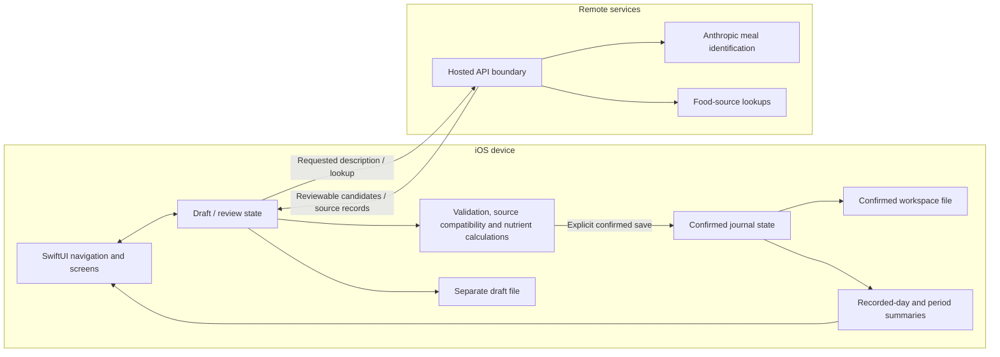
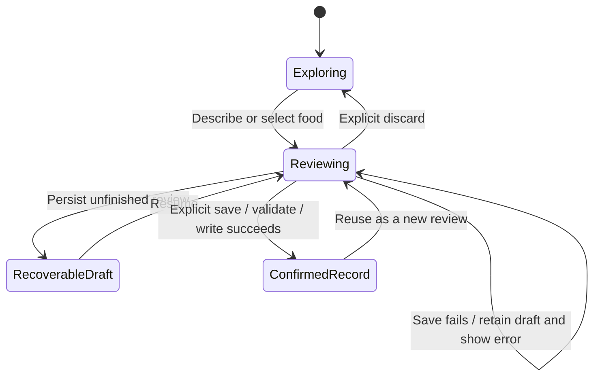

# Provision architecture

This is a public architectural summary of the native meal-review experience, grounded in a review of the private implementation. It intentionally omits source code, credentials, infrastructure addresses, and personal records.

[Back to the case study](README.md)

## System boundaries

This is a logical diagram, not a deployment inventory. Not every capture method, legacy tool, or optional service is represented.

## 1. Presentation and state ownership

The active native shell composes Today, Explore, Improve, Journal, and Insights. The review state is shared across the relevant screens so navigating away does not itself confirm a meal. Confirmed journal state and the in-progress review have different owners and persistence lifecycles.

**Tradeoff:** shared observable state keeps the current flow direct, but it needs careful handling of late network responses, replacement drafts, canceled edits, and relaunch recovery. These transitions have dedicated test cases in the private project.

## 2. Identification is a proposal; source data is evidence

In the meal-description flow, external analysis proposes food names and portions. The app obtains food-source candidates, retains their identity and nutrient basis, and lets the user inspect the match. The UI discloses remote analysis before the description is submitted.

Food preparation and measurement basis matter. A per-volume or unknown-basis source cannot simply be treated as a verified per-gram value. Ingredient edits reset the previous review check so a changed quantity or source is not presented as already verified.

**Tradeoff:** explicit review adds steps, but makes food identity and portion assumptions visible. It does not guarantee that a database match or user estimate is correct.

## 3. Drafts and confirmed records are different states

The state diagram is a conceptual summary. Draft persistence validates its own envelope, while the confirmed workspace validates the full candidate state before an atomic write. In-memory confirmed state changes only after that write succeeds. Recovery failures remain visible instead of silently replacing an unreadable file with an empty journal.

**Tradeoff:** JSON/Codable files keep storage small and straightforward for an on-device workspace. They are not a cloud synchronization protocol or evidence of concurrent multi-device behavior. Larger-history performance and migration compatibility need separate measurement and qualification.

## 4. Nutrition semantics preserve uncertainty

| State | Meaning in the interface |
| --- | --- |
| No meals | There are no confirmed records for the selected scope |
| Unknown | Records exist, but a nutrient amount is unavailable |
| Partial | A known subtotal exists, but some nutrient data is missing |
| Complete for recorded foods | The relevant nutrient data is available for the recorded items; the full day's intake may still be unlogged |

An explicit zero stays distinct from an absent value. Target comparisons also distinguish goals from ceilings. The implementation can warn when a known subtotal already exceeds a comparable ceiling without pretending the missing total is known. This is a data-model rule, not a clinical assessment.

**Tradeoff:** totals and comparisons may be withheld when evidence is incomplete. That is more faithful to the records than filling unknowns with zero or inventing a complete-day conclusion.

## 5. Privacy and remote processing

- Confirmed meals and unfinished reviews are stored on the device in separate files.
- The main experience is account-free; that does not mean all features are offline.
- Requested analysis and lookups cross a remote-service boundary. Local storage is not a promise that descriptions stay on the device.
- The implementation uses atomic writes and iOS file-protection options. That is distinct from a claim of end-to-end encrypted cloud storage.
- This case study contains example/QA screenshots only. It does not expose exported journals, backups, provider responses, logs, keys, or deployment configuration.

## 6. Test strategy and qualification

The private suite includes cases for changed ingredients invalidating checks, unknown-versus-zero values, source-basis compatibility, late lookup responses, failed writes retaining drafts, duplicate/retried saves, and relaunch recovery. UI tests cover portions of the review and journal journeys.

These are the failure modes the design needs to withstand. This publication verifies the public artifacts and checks the narrative against source; it does not claim a fresh complete XCTest pass, live-provider correctness, physical-device accessibility, App Store approval, or medical validation.

## Scope intentionally left open

The current five-destination experience is the subject of the screenshots. Later architecture proposals, under-13 use, expanded planning/pantry functions, cloud synchronization, and a redesigned navigation system are not presented as completed capabilities.
