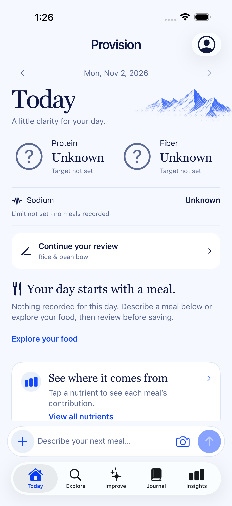
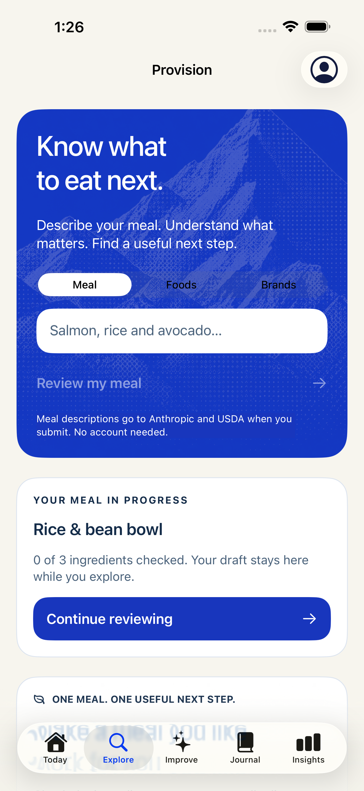
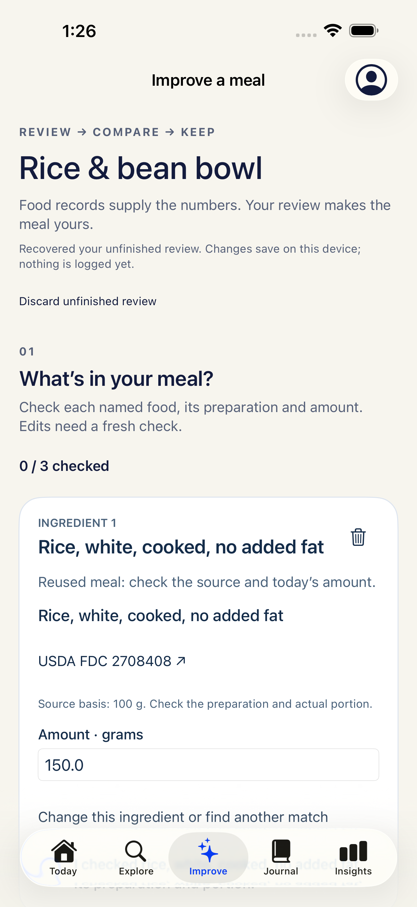
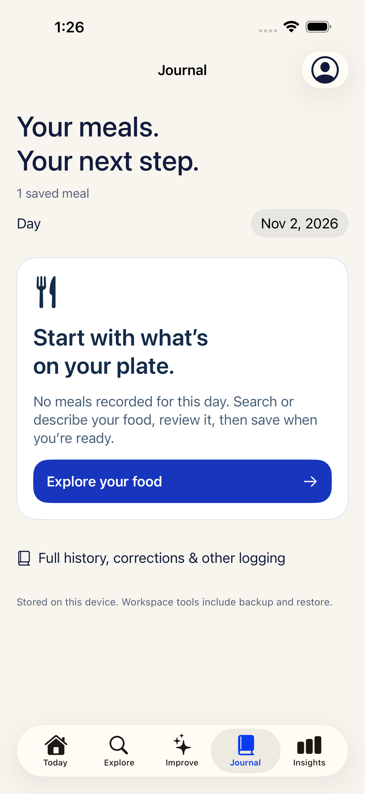
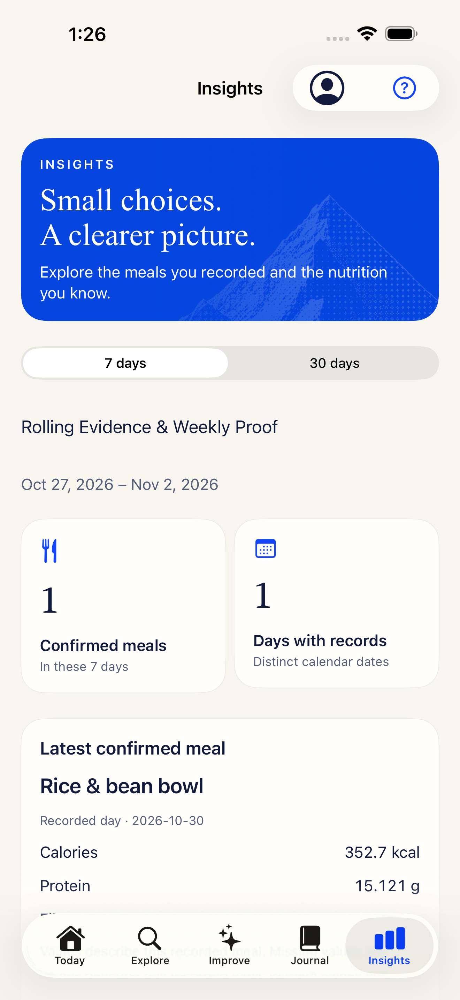
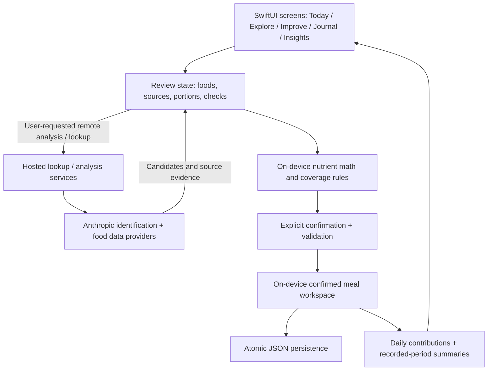

# Provision

### From a meal description to a reviewed nutrition record.

Provision is a native iOS nutrition app built around a simple loop: describe or find food, review its source and portion, save it deliberately, and understand what the recorded meals contribute.

The engineering challenge is preserving trust when food identification, source data, portion estimates, and incomplete nutrient records meet in one interface.

**Product engineering: [Yang Luo](https://github.com/yanglluo)** · [Portfolio](https://povhiringyang.vercel.app/) · [Architecture](ARCHITECTURE.md)

> **Public case study · Application source remains private.** This repository contains documentation and real simulator screenshots using QA/example records. Provision is in active development; these materials do not establish App Store availability or clinical validation.

## The product in five screens

<table>
  <tr>
    <th>Today</th>
    <th>Explore</th>
    <th>Improve</th>
  </tr>
  <tr>
    <td></td>
    <td></td>
    <td></td>
  </tr>
</table>

<table>
  <tr>
    <th>Journal</th>
    <th>Insights</th>
  </tr>
  <tr>
    <td></td>
    <td></td>
  </tr>
</table>

Captured **November 2, 2026**, from a simulator Release build with QA-only meals and drafts. These are actual app captures, not generated mockups. They document a dated build rather than every later source change. [Screenshot provenance and full-size images →](SCREENSHOTS.md)

## The problem and the approach

A food description is ambiguous. A matching database entry may describe a different preparation, use an incompatible serving basis, or omit a nutrient entirely. A polished total can conceal those differences.

Provision makes the review step part of the product:

1. **Explore:** enter a meal description or search for a food/brand source.
2. **Review:** inspect each ingredient's identity, preparation, source, and gram amount. An edit invalidates the previous check.
3. **Confirm:** turn the reviewed draft into a saved meal through an explicit action. Looking at an example or editing a draft does not log food.
4. **Understand:** view contributions for the recorded day and summaries over recorded periods, with missing data still visible.

The two sample meals shown across the captures illustrate different states: a saved reference bowl and a separate unfinished banana draft. They are not a before/after nutrition outcome.

## Engineering decisions worth discussing

| Decision | Implementation approach | Why it matters |
| --- | --- | --- |
| Separate identification from nutrition evidence | AI-assisted meal identification proposes foods and portions; source records carry nutrient values and a stated basis | An estimate remains reviewable instead of silently becoming a nutrition fact |
| Model unknown separately from zero | Nutrient coverage distinguishes no records, unknown values, partial subtotals, and complete values for recorded foods | Missing nutrient data cannot become an apparently precise zero |
| Keep drafts separate from confirmed meals | A review draft has its own persistence lifecycle and is reconciled with saved records | An interrupted review can be recovered without inserting an unconfirmed meal |
| Save before reporting success | Candidate workspace state is validated and written atomically before replacing in-memory state | A failed write can surface as a save error while preserving the review |
| Preserve food-source context | Source identity, preparation/basis, and portion checks travel with the reviewed food snapshot | Reuse and later corrections can be checked against the evidence that produced the numbers |
| Derive summaries from recorded meals | Daily and period views use confirmed records and coverage semantics | A partial diary does not imply a complete day's intake or a measured health outcome |

## Architecture at a glance

**Stack:** Swift · SwiftUI · Observation · Foundation/Codable · JSON persistence · hosted JavaScript API endpoints · Anthropic · USDA FoodData Central. The native source also includes branded-food lookup/cross-check services; provider availability and coverage vary.

The diagram describes the main meal-review path. Local journal storage and remote analysis are separate boundaries: an on-device diary does not make provider requests offline or local. [Read the architecture and failure-mode discussion →](ARCHITECTURE.md)

## What this work demonstrates

- Translating a nutrition product concept into a native flow with deliberate confirmation and recovery states.
- Designing domain models around source provenance, unit/basis compatibility, and incomplete information.
- Integrating external identification and food-data services while retaining a user review boundary.
- Connecting persistence behavior to what the interface promises after save, restart, reuse, and correction.
- Building test cases around difficult transitions rather than treating a successful screen render as sufficient validation.

## Validation and current boundaries

The private project includes XCTest cases for source/basis checks, missing-versus-zero semantics, invalid portions, explicit saves, duplicate save behavior, draft recovery, and failed writes, plus UI tests for core journeys. Their presence is evidence of test design; this case-study publication did not rerun the complete native suite or qualify a new release binary.

The screenshots were visually reviewed and their original SHA-256 hashes checked against the local capture manifest. A source review was used to ground the architecture narrative. No adoption, accuracy, health-improvement, accessibility-certification, or production-reliability metric is claimed here.

Current work still includes device/accessibility qualification, provider failure behavior, and release qualification. Proposed navigation simplifications, child-use policy, and a wider planning/pantry scope are unresolved product work, not features claimed by this case study.

## Explore the case study

- [Architecture, data boundaries, and tradeoffs](ARCHITECTURE.md)
- [Screenshot gallery and provenance](SCREENSHOTS.md)
- [Yang Luo's portfolio](https://povhiringyang.vercel.app/)

This is a documentation-only showcase. It is not an application distribution, and it does not include the private source, configuration, datasets, or user records needed to build or run Provision.
